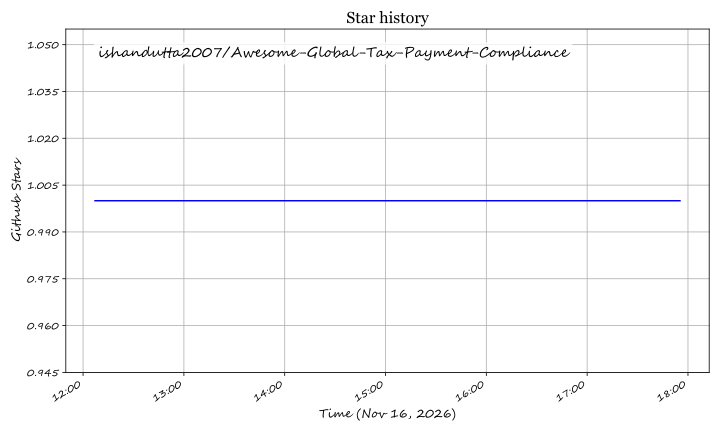

# 🌐 Awesome Global Tax & Payment Compliance 💳

  

  
  
  
  
  

---

## ⚡ Top Global Tax & Payment Compliance Ecosystem

> 🎯 **A curated directory of premier enterprise SaaS platforms and self-hosted open-source GitHub projects for automated tax calculation, VAT/GST cross-border compliance, nexus determination, and financial billing engines.**

This repository tracks notable **SaaS platforms** and **open-source developer libraries** for **Global Tax & Payment Compliance**. These tools help engineers and finance teams calculate, collect, and remit indirect taxes—sales tax, VAT, and GST—across jurisdictions, covering everything from commercial enterprise engines like Stripe, Avalara, and Vertex to open-source calculation primitives and nexus-determination libraries that handle core business logic without compounding per-transaction fees.

---

## 📑 Table of Contents
- [📊 Sector Overview & Market Dynamics](#-sector-overview--market-dynamics)
- [🏢 SaaS & Hosted Platforms](#-saashosted-platforms)
- [🔓 Open-Source GitHub Projects](#-open-source-github-projects)
- [📈 Star History](#-star-history)
- [💖 Support & Sponsorship](#-support--sponsorship)
- [🤝 How to Contribute](#-how-to-contribute)
- [⚖️ Disclaimer](#️-disclaimer)

---

## 📊 Sector Overview & Market Dynamics

The global tax compliance and management software market is estimated at approximately **$23 billion to $29 billion in 2026** (projected to reach over $50 billion by the mid-2030s at an ~11% CAGR). The sector is **moderately fragmented** due to disparate jurisdiction-specific rules, local e-invoicing mandates, and varying tax structures across countries; however, enterprise indirect tax calculation and filing remain heavily concentrated among a handful of multi-billion-dollar scale leaders (e.g., Stripe, Avalara, Vertex).

---

## 🏢 SaaS/Hosted Platforms

| 🏢 Product | 📈 Company Size (Valuation / Revenue) | 📝 Description | 💲 Pricing (Starting) | ⏱️ Free Tier / Trial Limits |
|---|---|---|---|---|
| **[Stripe Tax](https://stripe.com/tax)** | **$159B valuation** (~$6.8B net revenue) | Tax calculation and filing integrated directly into Stripe's payment platform. Supports sales tax, VAT, and GST across 100+ jurisdictions. | **0.5% per transaction** (no-code / Stripe Checkout) or **$0.50 per transaction** (Tax API); full compliance suite from **$90/month** | **No free tier or trial** (live production requires active paid transaction fees; testmode available for developers) |
| **[Avalara AvaTax](https://www.avalara.com/)** | **$8.4B valuation** at buyout (~$789M revenue) | **The enterprise standard for indirect tax calculation.** Real-time rate determination, exemption certificate management, and return filing across thousands of jurisdictions. Positioned for businesses with complex multi-state and international nexus. | Starts at **$69/month** (or **$699/year**) per state (Streamlined Sales Tax) / **$79/month** per state (non-SST); enterprise tiers require custom quote | **90-day free trial** for AvaTax evaluation/testing (capped at 5 orders/invoices per min, max 1,000 transactions/day; no permanent free tier) |
| **[Vertex Cloud](https://www.vertexinc.com/)** | **$2.9B market cap** (~$819M LTM revenue) | Enterprise tax technology for sales and use tax, VAT, and compliance. Deep ERP integrations (SAP, Oracle, Microsoft Dynamics). | Entry packages start from **$5,000/year** (mid-market median ~$33,000/year; custom quote based on revenue/volume) | **No free tier or trial** (enterprise evaluation via sales demo only) |
| **[TaxJar](https://www.taxjar.com/)** | **$850M–$900M valuation** (acquired by Stripe) | Sales tax automation with API, automated filing, and nexus tracking. Widely used by e-commerce and SaaS businesses. | Starts at **$39/month** (Starter Plan for up to 200 orders/month and 2 auto-filings/year) | **30-day free trial** (access to calculation and reporting features without auto-file) |
| **[Anrok](https://www.anrok.com/)** | **$250M valuation** (Series B, 2024) | **API-first sales tax and VAT compliance for SaaS and digital businesses.** Monitors nexus thresholds, calculates tax, and files returns. Positioned for software companies with global customers. | Starts at **$100/month per active market** (state/country) | **No free tier or public trial** (pre-sale sandbox evaluation available on request) |

---

## 🔓 Open-Source GitHub Projects

Curated list of self-hosted engines, primitives, rate datasets, and validation tools sorted strictly by GitHub_Stars:

| 📦 Project | ⭐ GitHub_Stars | 🛠️ Focus Area | 📝 Description |
|---|---|---|---|
| **[Invoice Ninja](https://github.com/invoiceninja/invoiceninja)** |  | Invoicing & Multi-Tax Engine | Complete self-hosted financial platform with multi-currency, multi-jurisdiction tax rate assignments, and custom tax rules built on Laravel. |
| **[Crater](https://github.com/crater-invoice/crater)** |  | Self-Hosted Invoicing & Tax | Open-source invoicing solution with compound and multi-rate tax support designed for freelance and SME financial management. |
| **[vat-calculator](https://github.com/laravel/vat-calculator)** |  | EU VAT / MOSS Engine | Handles EU VAT calculations, MOSS compliance, and real-time European VAT number verification via VIES. |
| **[OpenAccountants MCP](https://github.com/openaccountants/openaccountants)** |  | AI Agent Tax & MCP Knowledge | Model Context Protocol server giving AI assistants on-demand access to tax compliance skills, laws, and rules across 190+ countries and states. |
| **[ibericode/vat](https://github.com/ibericode/vat)** |  | PHP VAT Library & Rates | PHP library for European VAT rate resolution, geo-location tax lookups, and VAT number format validation. |
| **[node-sales-tax](https://github.com/valeriansaliou/node-sales-tax)** |  | Offline Node.js Tax Engine | International sales tax and VAT calculator for Node.js featuring offline tax tables, reverse charges, and VIES fraud verification. |
| **[valvat](https://github.com/yolk/valvat)** |  | Ruby VAT Validator | European VAT number validation for Ruby with format checksums and direct VIES web service validation. |
| **[commerceguys/tax](https://github.com/commerceguys/tax)** |  | Tax Data & Rate Resolvers | PHP library providing data models, tax zones, compound rates, and rate resolvers for global sales tax and VAT. |
| **[vat-rates](https://github.com/kdeldycke/vat-rates)** |  | VAT Dataset | Comprehensive JSON and YAML database of international VAT rates for standard, digital, and cloud services by country. |
| **[spatie/tax-calculator](https://github.com/spatie/tax-calculator)** |  | PHP Tax Calculation Primitives | Clean interfaces and methods to structure and calculate VAT and sales taxes across cart items and invoices. |
| **[Cbox Nexus (Laravel)](https://github.com/cboxdk/laravel-nexus)** |  | US Economic Nexus Engine | US economic-nexus tracking engine that accumulates sales per state and evaluates post-Wayfair threshold registration requirements. |
| **[NexusTax](https://github.com/azaharizaman/nexus-tax)** |  | Stateless Tax Engine | Framework-agnostic PHP calculation engine supporting reverse charges, partial exemptions, place-of-supply rules, and audit logs. |
| **[Eisphora](https://github.com/OrionUnix/Eisphora)** |  | Crypto Tax Calculator | Privacy-first crypto tax calculator using in-memory FIFO processing and stateless security without database persistence. |

---

## 📈 Star History

---

## 💖 Support & Sponsorship

If you found this curated list helpful for building your billing system or compliance pipeline, please consider showing your support:

- ⭐ **Star** this repository to help others discover it!
- 🍴 **Fork** and contribute new tools, libraries, or rate datasets.
- 📢 **Share** with colleagues and developers in fintech and accounting tech.
- ☕ **Buy me a coffee**: If you'd like to support ongoing curation and development, sponsor via [GitHub Sponsors](https://github.com/sponsors/ishandutta2007).

---

## 🤝 How to Contribute

1. 🍴 Fork the repository.
2. 📝 Add or edit entries in `README.md` following the established table structure and sorting conventions.
3. 🔗 Include official documentation links, exact pricing / free trial limits for SaaS, or Stars_Badges for open-source libraries.
4. 🚀 Submit a pull request with a concise summary of changes.

---

## ⚖️ Disclaimer

- This is an **independently curated community list** and does not constitute formal legal, accounting, or tax advisory.
- Indirect tax regulations (sales tax, VAT, GST, and e-invoicing mandates) differ substantially across global jurisdictions. Always verify tax calculations and reporting obligations against official tax authority guidance.
- Open-source tools provide calculation primitives and nexus detection logic; they do not automatically file returns or remit payments unless integrated into an end-to-end remittance pipeline.

---

  <b>Built for finance engineers, fintech builders, and billing developers worldwide 🌍</b>

## ⭐ Star History

<a href="https://star-history.com/#ishandutta2007/Awesome-Global-Tax-Payment-Compliance&Timeline" align="center">
  <picture>
    <source media="(prefers-color-scheme: dark)" srcset="assets/ishandutta2007_Awesome-Global-Tax-Payment-Compliance_growth.svg">
    
  </picture>
</a>
